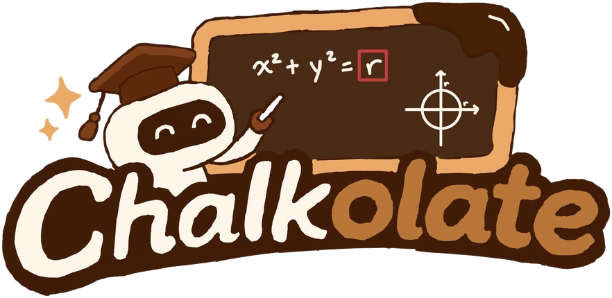
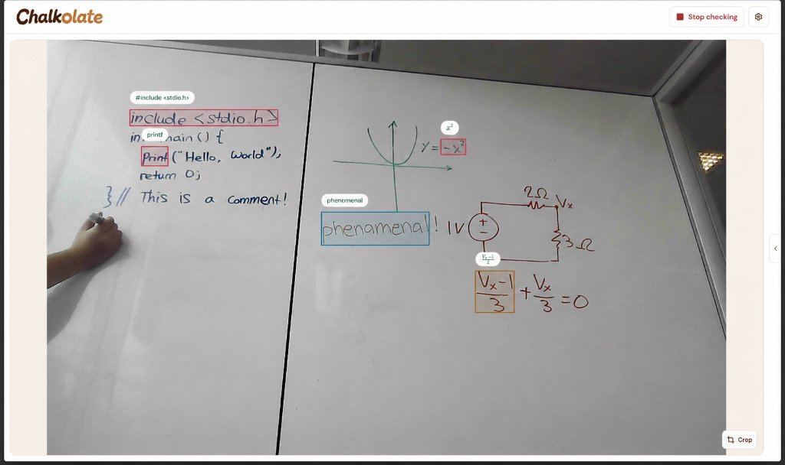

  

  <em>Smarter than the front row</em>

Catches math, physics, spelling, and other mistakes during lectures in real time by watching boards, screens, and videos. 🏆 Winner of the "Undo Button" theme at McGill CodeJam 16. Watch the [demo video](https://www.youtube.com/watch?v=5CWQiQBad44) or view the [Devpost submission](https://devpost.com/software/chalkolate).

## Problem

A missing minus sign, an incorrect unit, or a simple typo can completely change the result of a problem. Students often hesitate to interrupt the professor, so these mistakes can go unnoticed and end up in their notes, or waste valuable time when caught later.

## Solution

Chalkolate watches the board as the professor writes, checking equations, calculations, and text for mistakes. When it spots an error, it highlights the exact location on the video feed and suggests a correction on screen, out loud, or both. It also builds Markdown lecture notes in the background that you can download at the end of class. This helps the professor catch mistakes before they affect the rest of a derivation, and helps students avoid copying errors into their notes while minimizing interruptions to the lecture.

## Tech Stack

- **Frontend:** Next.js, React, TypeScript, KaTeX
- **Backend:** Python (FastAPI), OpenCV, Pillow
- **AI & Speech:** Gemini (`gemini-3.8-flash`), ElevenLabs (`eleven_v4_turbo`)

## How It Works

- **Video Input:** Captures a webcam, phone camera, shared screen, or uploaded video directly in the browser. You can crop and straighten an angled board using automatic corner detection or drag the corners into place yourself.
- **Smart Frame Gate:** Monitors the board for movement and waits for writing to settle before capturing a frame. This cuts down on unnecessary API calls and avoids checking half-written lines or moments when someone is standing in front of the board.
- **AI Analysis:** Sends the captured frame and a short summary of what was already on the board to Gemini. The model checks for math, physics, spelling, and factual mistakes, returning structured JSON with corrections, short explanations, and bounding-box coordinates while ignoring low-confidence guesses.
- **Live Alerts:** Highlights detected mistakes on the video feed with bounding boxes and KaTeX corrections, with optional ElevenLabs voice alerts (`Professor` reads just the correction, while `Student` adds the explanation). Tracked findings stay quiet across frames until fixed or erased, then clear on their own.
- **Lecture Notes:** Watches settled board changes separately to build Markdown and LaTeX notes (with board figures when helpful) in your current browser tab, ready to download or clear anytime.

## Team

Shirley Liu, Adnan Aidan Taha, Jongmin Lee, and Édouard Chassé (SAJE).
